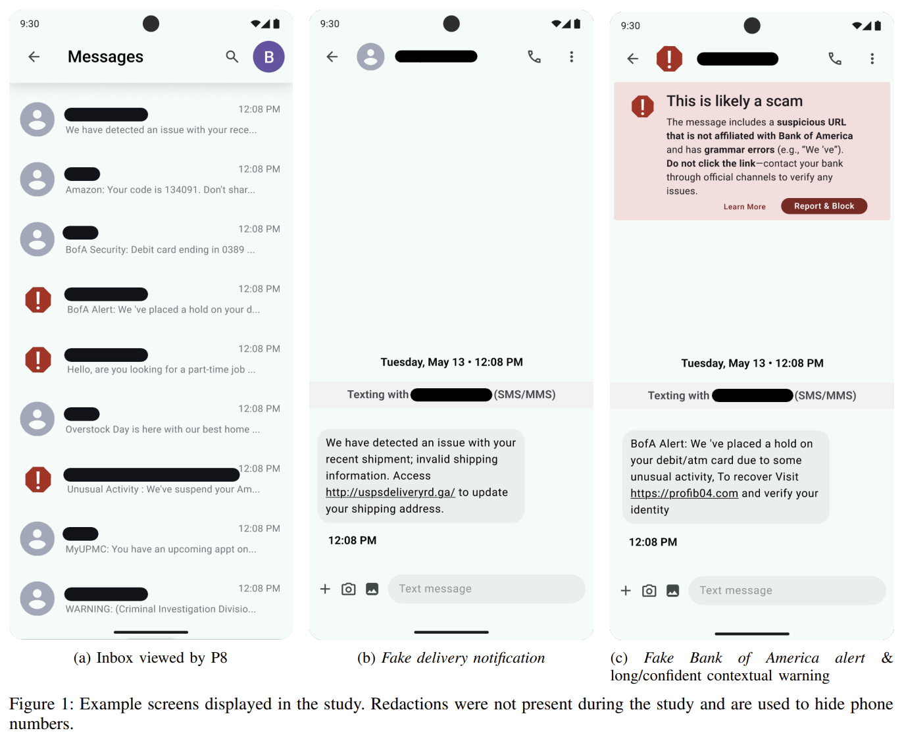
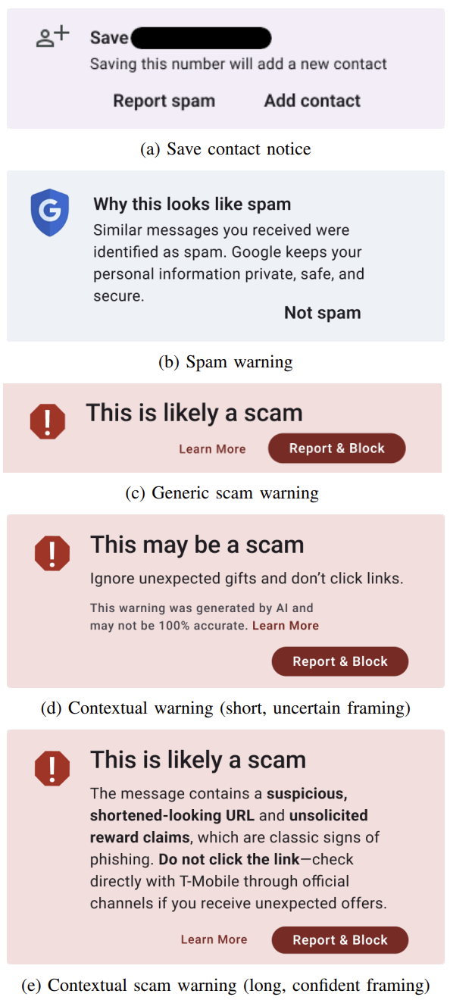
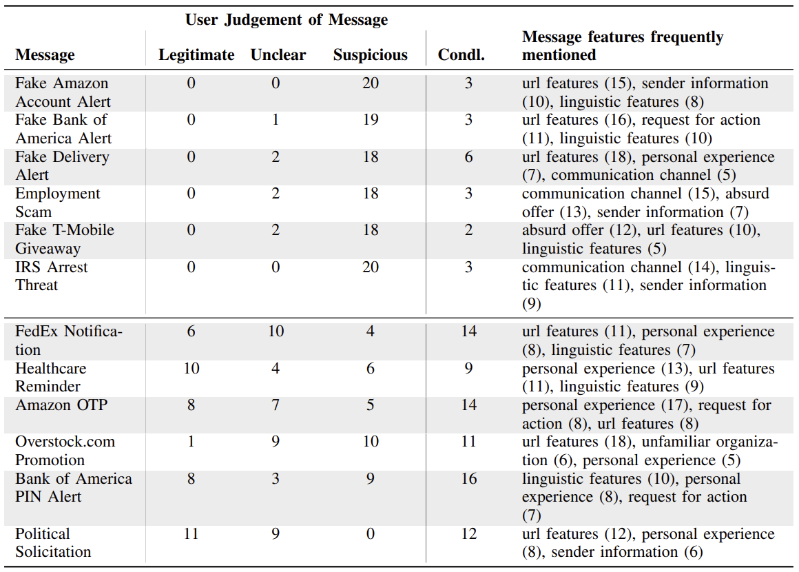
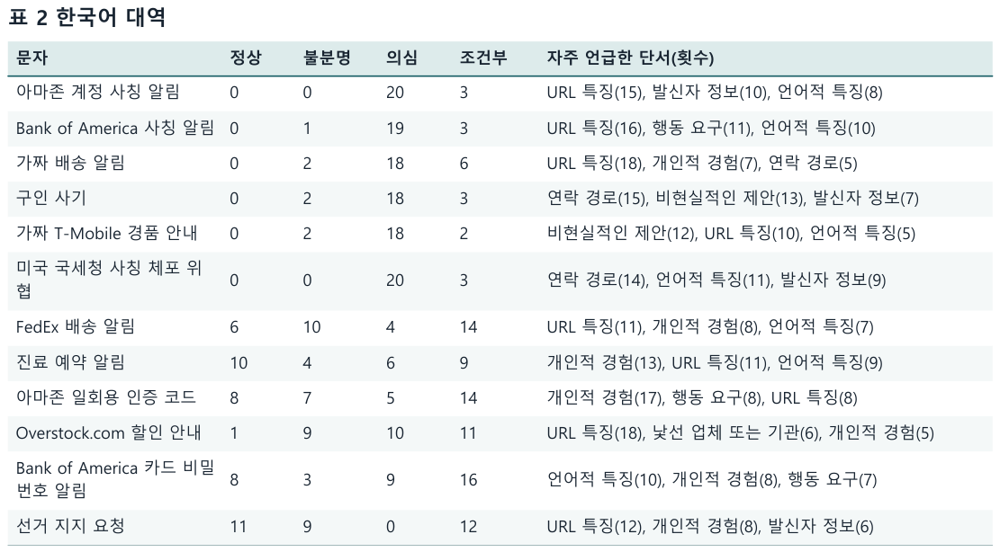

## From "Be Careful" to "Here's Why" : Investigating User Reasoning with Context-Specific SMS Scam Warnings 리뷰{#section-one}
위 논문을 한국어로 번역하면 이렇습니다!

[ "조심하세요"에서 "이유는 이렇습니다" : 맥락 맞춤형 문자 사기(스미싱) 경고를 통한 사용자 추론 과정 탐구 ]

즉, 휴대폰에 사기 메시지 관련 경고가 떴을 때, 사람은 뭘 보고 그 문자를 믿거나 의심하는지 살펴본 연구 입니다.

[논문 바로가기](https://alexliu0809.github.io/assets/files/sp26b.pdf)

논문을 리뷰하기 앞서 왜 이 논문을 선정했는지 이야기 해 보자면...

저희 학교에는 "도전학기" 라는 개념이 있습니다. 학생이 직접 학습 과정, 결과물 등을 선정하여 한 학기동안 학교에서 해당 활동을 지원해주는 프로그램이죠.

전공학점 3학점 취득이 가능하며 지원금이 나오기에 연구활동을 하기에도 좋은 프로그램이라, 친구들끼리 여러 보안 이슈에 대해 이야기 하던 중 최근 은행권도 그렇고 기업들이 개인정보를 탈취당하는 형태의 공격이 많이 일어나긴 했으나,

실제로 일반인들이 가장 와닿는 피해 유형은 피싱이라고 생각하여 피싱을 주제로 연구활동을 진행해보면 어떨까? 라는 생각에서 시작했습니다.

그래서 연구활동 시작 전 다른 피싱 논문들을 읽어 볼 필요가 있다고 생각하여 위 논문으로 선정하였습니다!

참고사항 : ``` 텍스트가 이 색상이면 제 개인적인 코멘트를 작성한 것 입니다. ```

### 1. 이들은 왜 이 연구를 시작했는가?{#section-two}
<b>문자메시지(Short Message System, SMS)는 오래전부터 쓰여 온 통신 수단이며, 사기범은 지금도 문자 메시지를 널리 이용한다.

문자 사기에 대응하는 시스템은 대개 의심스러운 문자를 자동으로 탐지한 뒤, 수신자에게 전달되기 전에 차단하거나 경고를 붙여 보여준다. 다만, 왜 그 문자에 경고가 붙었는지는 자세히 알려주지 않는다.</b>

이 논문의 저자들은 위와 같은 부분에서 이 연구를 시작했습니다.

<b>미국 연방거래위원회</b>에 따르면, 2024년에 신고된 문자 사기 피해액은 4억 7천만 달러로 2020년보다 대략 <b>500%</b> 증가했다고도 적혀있구요.

서론 부분에는 경고 설계에 관한 기존의 논문을 인용하여 사용자가 스스로 판단할 수 있도록 경고가 뜬 근거를 함께 제시하라고 권고한다고 합니다.

또, 기존의 AI는 어떤 근거로 문자를 사기로 분류했는지 파악하기 어려웠고 경고문에도 해당 문자의 어떤 점이 의심스러운지 구체적으로 설명하기 어려웠다고 합니다.

저자들은 생성형 AI는 이런 설명을 제공할 새로운 가능성을 열어준다고 기대하고 있구요.

최신의 언어 모델은 문자에 적힌 발신자 이름, 언급된 브랜드, 의심스러운 링크 등에서 여러 단서를 찾아내고 이를 사람이 일상에서 쓰는 말로 풀어서 설명할 수 있다고 주장합니다.

``` 저도 이 저자들의 생각에 공감이 가는게 저는 삼성 스마트폰을 사용중인데, ```

``` 통신사에서 제공하는 통신 앱을 보면 피싱과 관련하여 온 메시지를 스팸 보관함으로 옮겼다는 알림을 가끔 받습니다.```

``` 근데 막상 봤을때 해외 사이트 로그인하는데 2차 인증 번호가 오는것이 오탐되는 경우들도 가끔 있거든요?```

``` 그럴때 뭘 기준으로 잡는거지? 왜 잡힌거지? 이런생각이 든 적이 있었는데, 이런 부분에서 문제의식으로 삼고 시작한 것은 아닐까 조심스레 생각해봅니다.```

### 2. 이 문제를 어떻게 해결하려 했는가?{#section-three}
논문에서는 선행 사례와 연구들을 살펴보고 있습니다.

Google의 메시지를 주요 예시로 드는데 Google 메시지는 간단한 경고를 표시하지만 왜 그 문자에 경고가 붙었는지는 자세히 알려 주지 않는다고 하는데요.

적절한 지시를 주면 당장 행동하라고 재촉하는 표현이나 문자 내용과 맞지 않는 링크를 짚어, 그 문자에서 무엇을 주의해야 하는지 짧게 알려 줄 수 있고, 이런 경고는 사용자가 더 나은 판단을 내리는 데 도움이 될 수 있다고 합니다.

실제로 구글은 생성형 AI를 활용해 문자 내용에 맞는 사기 경고를 제공하겠다는 계획을 발표했다고 합니다.<br>
[관련링크](https://blog.google/innovation-and-ai/technology/safety-security/how-were-using-ai-to-combat-the-latest-scams/)

또 최근의 연구에서는 대규모 언어 모델(LLM)이 피싱 탐지 결과를 설명해 주면 사용자가 피싱 판별 과제를 더 잘 수행할 수 있다는 결과가 나왔다고 합니다.

다만, 이 연구들이 주로 평가한 것은 설명의 정확성과 표현의 품질을 위주로 평가했다고 하는데요. 그 설명이 실제 경고화면에 들어갔을 때 사용자가 어떻게 받아들이는지는 충분히 살펴보지 않았다고 합니다.

사용자가 설명을 접하는 곳은 경고 화면이며, 경고는 짧으면서도 눈에 잘 띄어야 하고, 사용자가 그 내용을 신뢰할 수 있어야 한다고 주장합니다.

문자 메시지에서 이러한 설계 요소가 사용자의 판단과 행동에 어떤 영향을 미치는지는 아직 충분히 밝혀지지 않았다고 합니다.

그래서 연구진들은 아래와 같은 질문을 던집니다.

1. 모르는 발신자가 보낸 메시지에 경고가 표시되면, 사용자는 무엇을 근거로 그 메시지를 판단하는가?
2. 경고를 어떻게 설계하느냐에 따라 사용자의 판단은 어떻게 달라지는가? 특히, 해당 메시지에 맞춘 설명을 "짧게 제시할 때"와 "자세히 제시할 때" 어떤 차이가 있는가?

```저는 위 내용에 또 한번 공감이 가네요!```
```사용자는 실제로 경고창에서 경고를 확인하는데 해당 경고창 안에 텍스트를 매우 정확하게 표현도 정말 사람이 이해하기 쉽게 했다고, 해도 결국 그걸 보여주는 UI가 사용자 입장에서 가독성이 떨어지는 구조로 되어있다고 하면? 저라면! 결국 안보고 넘길 것 같아요.```

아무튼, 저자들은 위 질문에 답하기 위해 Google 메시지 앱을 실제와 가깝게 재현한 화면을 사용해 20명을 대상으로 과제 수행형 인터뷰를 진행했다고 합니다.

참가자들이 사기 의심 문자에 붙은 경고를 어떻게 해석하고 이에 어떻게 대응하는지 살펴보았다고 해요.

이들의 연구 방법은 아래와 같습니다.



#### 참가자 모집
- 미국에 거주하는 만 18세 이상 안드로이드 사용자 20명을 모집
- 참가자가 처음부터 경고에만 주목하지 않도록, 모집할 때는 "모르는 발신자의 문자에 사람들이 어떻게 대응하는지 알아보는 연구"라고 안내함.

#### 인터뷰 절차
- Google 메시지 앱을 비슷하게 만든 화면에서 가상의 인물 "밥"이 받은 문자 12건을 한 건씩 보여줬습니다.
- 인터뷰 진행자는 매번 "밥이 어떻게 대응하면 좋을지, 왜 그렇게 생각하는지"를 물었다.
- 경고가 표시된 문자에서는 그 경고가 판단에 영향을 주었는지도 물었습니다.

#### 문자 선정
- 사기 문자 6건과 정사 문자 6건을 골랐다. 사기 문자는 실제 신고 사례를 모은 SmishTank에서 선정했다.
- 정상 문자에는 실제 배송 알림, 진료 예약 안내, 일회용 인증번호처럼 사기 문자와 혼동할 수 있는 사례를 포함했다.

#### 경고 설계
- <b>연락처 저장 안내, 스팸 경고, 일반 사기 경고, 짧고 조심스럽게 표현한 상황별 경고, 길고 확신 있게 표현한 상황별 경고</b>의 다섯 가지를 준비했다.
- 첫 정상 문자와 첫 사기 문자는 경고 없이 보여주고, 나머지 사기 문자에는 경고를 배정하고 정상 문자 한 건에도 일부러 잘못된 경고를 붙였다.

#### 답변 분석
- 인터뷰를 녹음해 글로 옮긴 뒤, 참가자가 <b>어떤 행동을 권했는지, 왜 그렇게 생각했는지, 경고가 그 생각에 어떤 영향을 줬는지</b>에 따라 발언을 분류했다.
- 연구진은 일부 인터뷰를 함께 검토하며 분류 기준을 다듬은 뒤 나머지 인터뷰에 적용했다.

#### 방법의 한계
- 마지막 절에서는 참여자의 지역과 표본 규모, 모의 문자함을 사용하는 인터뷰 환경이 연구 해석에 주는 제약을 설명했다.



위 figure 2는 사칭 문자에 서로 다른 안내를 띄운 예시라고 설명합니다.

논문에서는 c, d, e를 비교해 보라고 하는데요. "c는 사기일 가능성이 큽니다" 라고만 하는데 d는 "예상하지 못한 선물은 무시하고 링크를 누르지 마세요" 라고 행동을 알려줍니다. e는 한걸음 나아가 단축 주소처럼 보이는 링크와 요청하지 않은 경품 제안이 왜 의심스러운지 짚어줍니다.

``` 개인적으로는 e가 더 신뢰가 가는군요. 뭐가 문제인지, 어떤 것을 하면 안되는지 명확히 알려줘서 더 신뢰가 가는 것 같습니다!```

### 3. 벤치마크 결과는?{#section-four}



위 표는 원본 논문의 테이블 2 입니다.

경고 종류별 성능표가 아닌, 문자 한 건씩을 참가자들이 어떻게 판단했는지 보여주는데요.

위쪽 여섯 행은 사기 문자이며, 아래쪽 여섯 행은 정상 문자라고 합니다.

저는 솔직히 영어 못하는지라... GPT 6.2 Astra를 통해 표를 한국어로 번역했습니다.



가짜 배송 알림은 20명중 18명이 의심스럽다고 판단했네요.

진짜 FedEx 배송 알림도 정상이라고 분명하게 판단한 사람은 6명밖에 없고 10명이 불분명하다고 판단했으면 4명은 의심스럽다고 봤다고 합니다.

표에서 말하는 "조건부"는 별도 집계를 의미한다고 합니다.

상황에 따라 행동이 달라질 것 같다 라고 답한 경우에 "조건부"에 해당한다고 하네요.

또한, 연구진은 참가자마다 정상 문자 한 건에도 일부러 잘못된 경고를 붙였다고 합니다.

그 문자를 본 20명은 중 11명은 신고하고 차단하라고 권했고, 경고가 잘못됐다고 말한 사람은 4명이었다고 합니다.

``` 저는 평소에 메일을 자주 보는 편인데, 가끔 제가 로그인 하지 않았는데 구글 계정으로 로그인 했다고 오는 경우가 꽤 자주 있거든요?```

```그때마다 아. 털렸나? 비밀번호 또 바꿔야겠네... 이러고 그냥 바꿔버렸었는데. 이런 결과를 보고 나니 오탐일수도 있었겠구나 하는 생각이 드네요. ```

#### 경고 설계 요소의 영향.

서로 다른 경고 설계에 참가자들이 어떻게 반응했는지 살펴본 자료도 있습니다.

참가자들의 반응에서 경고 유형이 달라도 되풀이되는 몇 가지 설계상의 갈등이 드러났다고 합니다.

무엇을 해야 하고, 왜 그래야 하는지 분명하게 알려주는 상황별 안내를 높이 평가했다고 합니다.

하지만 설명이 지나치게 길면 독자가 읽는게 버거워질 수 있었기에 확신을 담아 주의를 촉구하는 표현은 경고를 따르도록 유도했지만, AI가 생성했다고 밝히는 문구는 불확실성을 더해 신뢰를 떨어뜨렸다고 하네요.

한 번 눌러 "신고 및 차단"을 할 수 있는 버튼 등으로 대응을 쉽게 만드는게 중요했고, 빨간색이나 위험 이모티콘 같은 뚜렷한 시각적 단서가 경고를 눈에 잘띄게 하며 긴박감을 높였다고 하네요.

``` 빨간색이 시각적으로 가장 먼저 눈이 가는 것 같긴 하네요! 제 메일에도 빨간색으로 위험 혹은 경고 메일이 있으면 좀 불안하고 긴장될 것 같네요... ```

### 4. 이들의 논문의 한계점은 무엇일까?{#section-five}
이 논문의 한계점은 아래와 같이 이야기 하고 있습니다.

1. 참가자의 대표성이 제한적이다.
- 미국 안드로이드 사용자 20명을 인터뷰했고, 대부분 피츠버그에서만 모집했으며 교육 수준도 높은 편이었기 때문에 다른 지역이나 배경의 사용자도 같은 반응을 보일지는 알기 어렵다고 합니다.

2. 인터뷰에서 말한 행동과 실제 행동은 다를 수 있다.
- 참가자는 임의의 문자앱을 보며 "밥이라면 어떻게 해야 할지"를 설명했다. 일상에서 문자를 몇 초 만에 훑어볼 때도 경고를 자세히 읽을지, 경고를 오래 반복해서 보면 반응이 어떻게 달라질지는 확인하는게 사실상 어렵다.

3. 어떤 경고 요소가 참가자의 반응을 바꿨는지 따로 확인하기 어렵다.
- 짧은 경고는 조심스러운 어조제 AI의 오류 가능성에 대한 안내가 붙었고, 긴 경고는 더 단정적인 어조로 구체적인 근거를 제시했는데, 여러 요소가 함께 달라져서 반응 차이를 설명 길이 하나의 효과로는 볼 수 없을 것 같다.

4. 응답 횟수를 일반 사용자 전체의 비율로 해석할 수 없다.
- 이 연구는 사람들이 어떻게 판단하는지 알아보는 질적 인터뷰이기 때문이다.

5. 보여준 사기 사례와 경고 종류가 제한적이다.
- 다른 사기 문자를 제시하면 경고의 내용도 달라지고, 참가자가 주목하는 단서와 반응도 달라질 수 있다.

6. 앞선 문자가 뒤의 판단에 영향을 줬을 수 있다.
- 제시 순서를 무작위로 섞었어도, 참가자가 이전 문자에서 얻은 경험이나 같은 과제를 반복하면서 느낀 피로를 없앨 수는 없기 때문이다.

### 5. 추후 어떻게 이 연구를 확장할 수 있을까?{#section-six}

이 논문의 저자들은 자신들의 연구를 추후 두 가지 형태로 다시 해야한다고 제시합니다.

1. 실제 사용 환경에서 장기간 관찰하기
- 사람들이 일상에서 경고를 접할 때 어떻게 대응하는지, 시간이 지나면서 반응이 달라지는지 살펴본다.

2. 실험실에서 일상적인 제약을 재현하기
- 문자를 확인할 시간을 제한하거나 다른 과제를 동시에 수행하게 해서, 주의가 분산된 상황에서도 경고가 어떤 역할을 하는지 시험합니다.

``` 도전학기의 주제가 "사칭형 피싱"을 탐지하는 것이 메인 연구 주제입니다. 그렇다 보니 이번 논문은 어느 부분을 좀 집중해서 봐야 하는지를 알려줄 수 있었던 논문인 것 같습니다. 위에 적혀있듯이 제가 생각하지 못했던 부분 중 하나가 "일상적인 상황, 실제 사용 환경"인 것 같습니다. ```

``` 그저 막연하게 피싱 문자가 왔을때 어떤식으로 탐지 할까?가 질문 이었는데 세세하게 상황 하나하나 고려해야 한다는 것을 인지하게 되었네요. 이번 논문 리뷰는 굉장이 중요한 경험이라고 생각합니다.```

위에서는 이 논문에서 이야기 하는 확장 연구였고, 제 개인적인 생각을 이야기 해보자면

이 논문에서 서론부분에 이야기 한게 있는데, 선행 연구들은 AI가 생성한 "설명의 정확성", "표현의 품질"을 위주로 평가했다고 하는데, 그 설명이 실제 경고화면에 들어갔을 때 사용자가 어떻게 받아들이는지는 살펴보지 않았다고 했잖아요?

즉, 이 논문은 사용자가 받아들이는 반응을 연구한 것이기 때문에 아예 UI가 완전 다른 상황에서 여러 경고창을 띄운다던가.

같은 디자인 환경에서 모양이 다른 경고창을 띄웠을 때 어떤 것이 사용자에게 있어 더 위협적이고 긴장감을 고조시키듯 다가왔는지에 대한 연구를 해보면 좋을 것 같다고 생각합니다.

또, 경고하는 색상과 신고 버튼이 실제 행동에 정말 영향을 미치는지에 대한 실험도 해볼 수 있을 것 같아요.

``` 제가 논문을 처음 접할때만 해도 "지금껏 누구도 발견하지 못한 새로운 지식이 담긴 문서" 정도로 인식하고 있었는데 이런 형태의 논문을 서베이 형태의 논문이라고 하는건가요? 마냥 어려운 개념만은 아니었구나 하고 느꼈던 것 같아요! ```

이상으로 논문 리뷰 마치겠습니다.

긴 글 읽어주셔서 감사합니다.