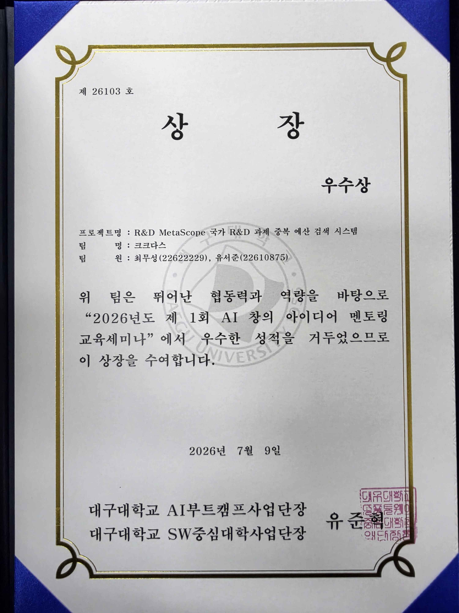

## AI 창의 아이디어 부트캠프 우수상 수상! {#section-one}
일시 : 2026년 7월 9일

## 참여 계기 {#section-two}
학교에서 엘레베이터에 붙어있는 홍보 포스터를 보게 되었습니다.  

정말 솔직하게 이야기 하자면 "아이디어 부트캠프" 라는 문구와 "호텔 뷔페 제공"이라는 문구만 눈에 보였습니다.  

이거 보고 반드시 참여해야지 라는 마음을 먹게 되었구요...(ㅋㅋㅋ)  

그래도 참여하게 된거 열심히 한번 해보자고 마음 먹고 진행했습니다.

## 진행 과정 {#section-three}
이 프로그램의 주제는 "AI 공공데이터 기반 아이디어"를 제시하는 것 이더군요.  

평소 친하게 지내던 1학년 친구와 함께 이번 프로그램에 팀으로 참여 했습니다.  

이번 프로그램 진행 하면서 처음으로 공공데이터 포털을 보게 되었는데, 생각보다 엄청 많은 기관의 데이터가 있더군요!

사실 너무 오래된지라 제일 처음에 정했던 주제는 기억이 잘 나진 않습니다.  

다만 한국산업기술기획평가원(Keit)의 공공데이터를 사용하려고 했던 기억은 있군요.

이 프로그램에서 자체적으로 멘토님과 매칭 시켜 주셔서 총 2번의 멘토링을 진행 했습니다!  

너무나 좋은 멘토님들(Theori 등)을 만나 아이디어를 더 좋은 방향으로 발전시킬 수 있었다고 생각합니다.

## 최종 아이디어 {#section-four}

멘토링을 바탕으로 최종적으로 진화시킨 저희의 아이디어 이름은 "<strong>R&D MetaScope</strong>"입니다!  

위에서 라는 뜻의 Meta, 살펴보는 기구라는 뜻의 Scope를 합친 이름으로 국가 R&D 전체를 내려다 본다는 의미를 담았습니다.  

실구현이 아닌 아이디어를 제시하는 것인 만큼 위에서 보시는 것 처럼 실구현 프로젝트보다 더 넓은 범위를 타겟으로 할 수 있었다는 점이 좋았습니다!  

### 제안 배경

2012년 16조 원이던 정부 R&D 예산은 26년기준 35.5조 원으로 10년만에 두 배 넘게 늘었습니다.

그러나 이 거대한 예산 안에서 중복 투자를 걸래내는 도구는, 그때나 지금이나 그대로 이더군요.

이번 저희 아이디어는 그런 문제의식에서 출발합니다.

R&D 과제중 유사 중복은 국가적 쟁점입니다. 실제로 지난 24년 정부는 유사중복 정비를 명분으로 R&D 예산을 조 단위로 감액했습니다.

25년도 감사원 감사에서도 투자 확대에 비해 성과가 세계 수준에 미치지 못한다는 지적이 나왔구요.

정리하자면 중복을 이유로 조 단위 예산이 오갔지만, 정작 '무엇이 중복인지'를 데이터로 판별할 수단은 없었습니다!

### 이미 있는 차별성 검토 기능?

NTIS(국가과학기술지식정보서비스)에는 이미 차별성 검토라는 기능이 있습니다.

R&D 과제중 텍스트 기반으로 비슷한 과제가 있는지 찾아주는 서비스더군요.

방금 말했듯이 이 서비스는 "텍스트 기반"으로 매칭해서 비슷한 과제를 찾아줍니다.

즉, 단어는 다른데 의미는 비슷한 경우 탐지되지 않고 넘어가는 것이죠.

예시로 "자율주행차 사고 예방 기술" 과 "무인 자동차 충돌 방지 시스템"은 겹치는 단어가 하나도 없지만 사실상 같은 연구라 볼 수 있습니다.

이런 부분까지 함께 찾아볼 수 있게 저희는 이번 아이디어를 내게 되었습니다!

### 핵심 기능

KEIT 공공데이터에서 과제명과 목적을 임베딩 모델을 통해 벡터로 변환합니다. 단어가 달라도 뜻이 같으면 벡터값 좌표상 가까운 위치에 놓이기 때문에 이를 기반으로 중복을 군집화 합니다.

이를 바탕으로 로컬LLM을 연동하여 담당자에게 보고서까지 제출하는 것이 저희가 낸 아이디어 였습니다!

여기서 로컬 LLM을 쓰는 이유는 추후 확장시 더 민감한 개인정보가 포함될 수 있기에 가정을 로컬 LLM으로 했습니다.

## 결론{#section-five}
최종 피칭 대회에서 전문가분들 앞에서 최종 발표 후 전문가 분들의 평가에 따라 순위가 결정 되었습니다!

저희 아이디어를 더 확장시키면 국가 R&D 전체를 범위로 같은 과제에 중복 투자되는 문제를 방지할 수 있겠다는 피드백을 주셨습니다!

앞선 피드백과 함께 저희 아이디어를 좋게 봐주셔서 우수상을 수상할 수 있었던 것 같습니다! 

이번 프로그램을 참여하게 된 계기는 정말 사소했지만 마감일 거의 다되서 정말 열심히 했던 것 같습니다...

다음에도 이런 프로그램은 꼭 참여해보고 싶네요 이상입니다.