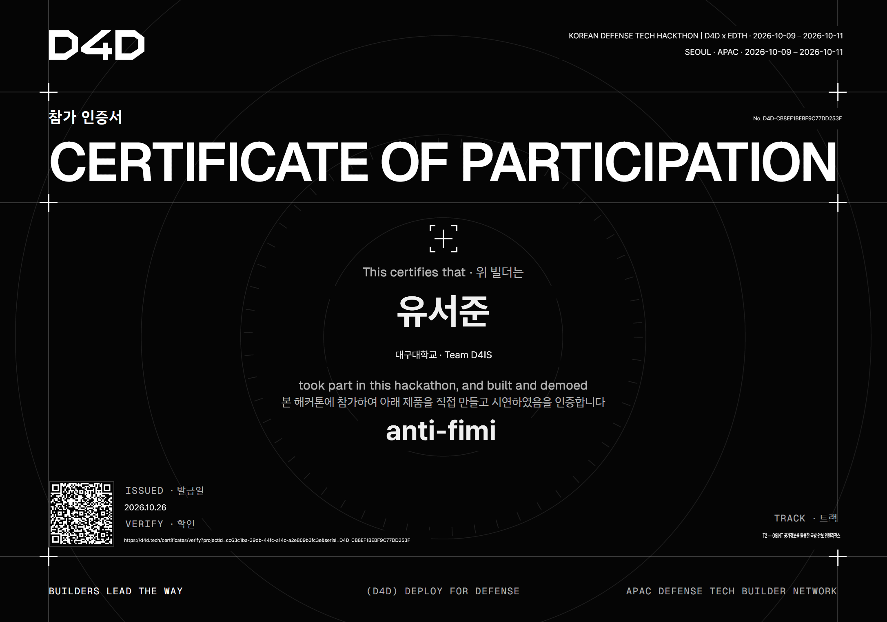

## 참여 계기{#section-one}

평소 친하게 지내던 선배 한분께서 먼저 제안을 주셨습니다!

이런 해커톤을 하는데 함께 나가겠냐고 제안을 주셔서 새로운 경험이 될 것 같아 참여하기로 하였습니다!

이번 해커톤의 경우 무박2일의 일정으로 국방과 관련된 문제를 해결하는 것이 주요 주제였습니다!

정말 다양한 분야, 다양한 국적, 해커톤 경험이 풍부하신 분들 등 너무 대단하신 분들이 많이 참여하셔서 시작전에 겁부터 많이 먹은 상태로 진행 했었습니다!

## 진행 {#section-two}

서울의 강남에서 진행하였으며, 저희 팀(3인)은 근처에 저렴한 숙소를 잡고 본대회 1일전에 도착해 있었습니다!

그 이유는 1일전에 진행하는 네트워크 세션에 참여하기 위해서 였으며, 대회 주최진 분들과 가벼운 토킹도 해볼 수 있었습니다.

저녁에 가볍게 진행하는 느낌이니만큼 숙소에 가서 쉬고 다음날 아침, 다시 그 장소에 모여 본 대회를 진행 했습니다.

함께 하게된 선배분들이 너무 유능하신 분들이라 막히는 부분 없이 다 잘 될줄 알았습니다......만

여기서 좀 큰 사고가 발생합니다.

## retire {#section-three}

오후 22시쯔음 무박 2일이라곤 하지만 피로가 쌓일대로 쌓여있던 참이라 선배 한분과 함께 사우나에 가서 잠시 샤워를 하고 오는데...

빠르게 복귀하기 위해 따릉이(전기자전거)를 타고 돌아오던 중 큰 턱에 걸려 넘어져 왼손이 보도블럭에 심하게 긁혀버리고 말았습니다.

너무 쎄게 긁혀서 피가 심하게 나던차라 어쩔 수 없이 근처 응급실에 찾아갔습니다.

대형 응급실이라 대기인원이 많았고, 솔직히 제가 봐도 저보다 심한 증상의 환자분들이 많이 계셔서 어쩔 수 없이 약국에 가서 임시로 조치만 취했습니다.

이후 대회장에 복귀하고 있었는데 다친부분에 계속 욱신거려 도무지 키보드 작업이 가능한 상황이 아니라고 판단하여 팀원분들께 양해를 구하고 저는 하루 먼저 복귀했습니다.

## 결론 {#seciton-four}

팀원 분들과 함께 하지 못했던 것이 끝나고 나니 계속 마음에 걸리고 너무 아쉽게 느껴지더군요.

대회 도중 밖에 나간것이 잘못된 선택 이었던 것 같습니다.

글을 작성하는 지금(26년 10월 26일)도 상처가 완전히 나아지지 않았습니다. 이제 새살이 돋아나는 중입니다.

다친건 사실 크게 신경쓰이지 않습니다. 팀원들과 함께 마무리하지 못했다는 것이 너무 불편하고 항상 팀원분들 얼굴 볼때마다 미안한 마음이 생기더군요.

정말 열심히 완성도 높은 작품 완성 해 주셨는데 괜히 저 때문에 영향가서 수상 못한 것 같은 느낌도 받고...

여러모로 미안한 마음이 많이 생긴 대회였던 것 같습니다.

무튼 대회 자체의 퀄리티나 대회 참여자 분들에 대한 편의는 최대한 봐주셔서 좋은 환경에서 대단하신 분들이 작업하는 과정을 보는 것 만으로도 충분히 값진 경험을 했다고 생각합니다.

다음에는 꼭 대회장을 벗어나지 않아야겠습니다... 이렇게 또 하나 배워가는군요.

계속 성장해야 겠습니다...