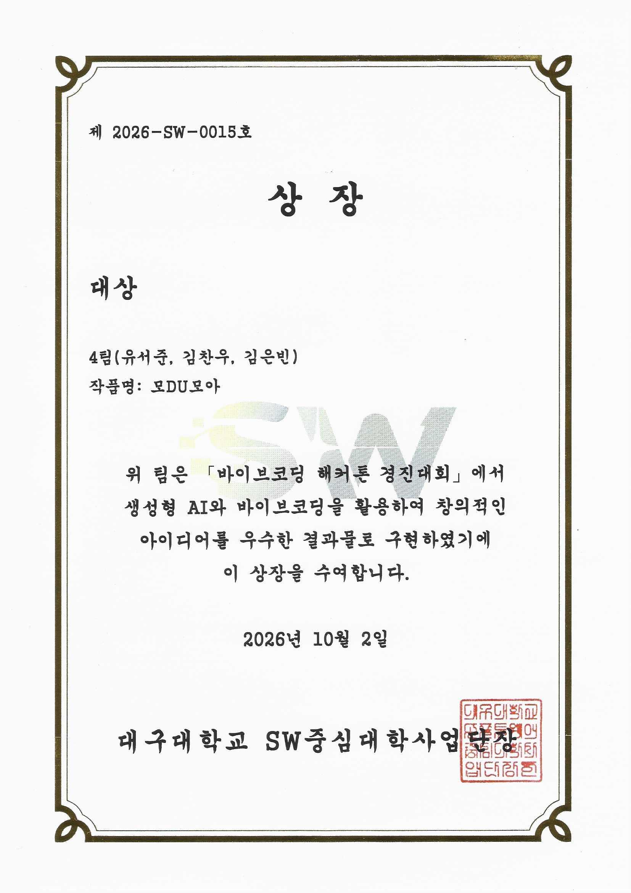
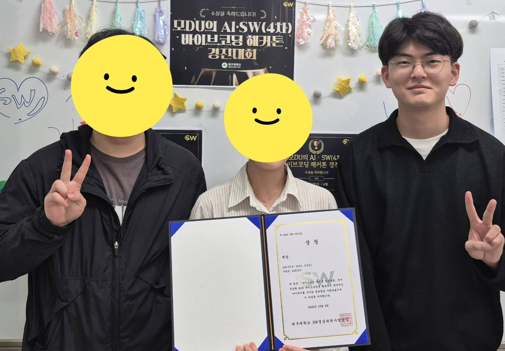

## AI · SW 바이브코딩 해커톤 대상

일시 : 2026년 10월 02일

## 참여 계기 {#section-one}

이번 프로그램은 1박 2일, 경주 소노캄 호텔에서 진행되는 바이브코딩 해커톤 입니다!

평소 친하게 지내던 선배들과 함께 신청하게 되었습니다.

안타깝지만, 팀은 SW중심대학 사업단에서 임의로 선정 해 주시더군요!

비전공 학과도 함께 참여하는 프로그램이라 컴공 학과가 몰리면 상대적으로 불리할 수 있으니 이런 조치를 취하신게 아닌가 싶습니다.

그렇게 이번에 저희팀은 정말 우연하게도 저희 학과 선배 한분과 저, 그리고 사회복지학과 4학년 분이 함께 팀원이 되었습니다!

## 아이디어 {#section-two}

저희 아이디어는 사회복지학과(앞으로 빈님이라고 부르겠습니다! 본명이 은빈님 이셔요!) 빈님께서 아이디어를 제안 해주셔서 저희 학교 내에서 진행하는 프로그램이 외국인 유학생 분들께는 상대적으로 덜 알려져 있을 수 있다는 부분을 문제점으로 삼아 아이디어를 제안 해 주셨습니다!

이후 브레인스토밍 과정에서 살을 좀 더 붙여 최종적으로 다음과 같은 아이디어가 탄생했습니다!

작품명 "모DU모아"

교내에는 정말 다양한 사업단과 협력단 등에서 수많은 프로그램 모집 공고가 올라옵니다.

(ex. 바이브코딩 참여자모집, 해외 학회 참관자 모집 등...)

이런 모집 공고는 참여하고 싶은 사람 본인이 직접 해당 사업단이나 협력단의 공지사항 페이지를 하나하나 전부 확인을 해야하는데요.

이런 부분이 불편하여 저희는 이 공고를 전부 모아주고, 일부 프로그램의 경우 팀과 함께 신청이 필수인 프로그램이 있습니다.

해당 프로그램은 팀원을 본인이 직접 구하지 못하면 신청의 기회조차 없는것이 문제였죠.

이런 부분도 함께 해결하고자 본인이 원하는 프로그램에 대한 공고를 올릴 수 있고 해당 공고를 통해 팀원을 모집할 수 있는 기능을 만들었습니다!

물론 아이디어의 시작이 외국인 유학생 분들을 대상으로 하기에 외국어로 보여줄 수 있는 기능도 제공하구요!

## 구현 과정 {#section-three}

이번 바이브코딩 해커톤의 경우 본인들이 직접 외부의 LLM을 가져와 빌딩하는 것이 아닌, 팀 모노리스 라는 곳에서 준비해주신 플랫폼을 이용하여 빌딩하는 것 이었습니다.

헌데 해당 모델의 컨텍스트 윈도우가 기본적으로 작은건지 혹은 해당 플랫폼에서 내부적으로 하네스를 넣은것이 상당한 컨텍스트를 차지한느 것인지 모델이 생각보다 잦은 간격으로 할루시네이션 증상을 보이더군요.

함께 하게된 학과 선배분과 방도 같은 방을 배정받아서(2인 1실!) 여차저차 밤새가면서 열심히 빌딩해 보았습니다.

## 최종 발표 {#section-four}

다음날 최종 발표일이 되었습니다.

한 팀씩 대표 한명 혹은 팀원 전체가 나가서 자신들이 빌딩한 것을 설명하는 시간을 가졌습니다.

정말 다양한 상황과 유용한 기능들을 보며 저런식으로 만들 수도 있었겠구나 하고 느낀점이 있었네요.

앞선 팀들의 발표를 듣고 드디어 저희 팀!

저희의 발표는 빈님이 대표로 맡아주셨습니다! 그런데...

발표를 너무 깔끔하게 너무너무 잘 해주셨습니다! 상황별로 기능을 하나하나 설명 해주시고 후킹도 적절하게 섞어가며 발표 하시더군요.

정말 너무너무 부러운 능력입니다... (솔직히 발표점수가 상당히 크지 않았을까 싶네요)

## 결론 {#section-five}

결과 저희는 "대상"을 수상하게 되었습니다!

정말 모두가 열심히 참여하고 밤새 개발한 것이 좋은 결과로 다가와서 더 의미하는 바가 큰거같습니다.

다음에도 비슷한 대회가 있다면 꼭 참여 해 봐야겠습니다.
