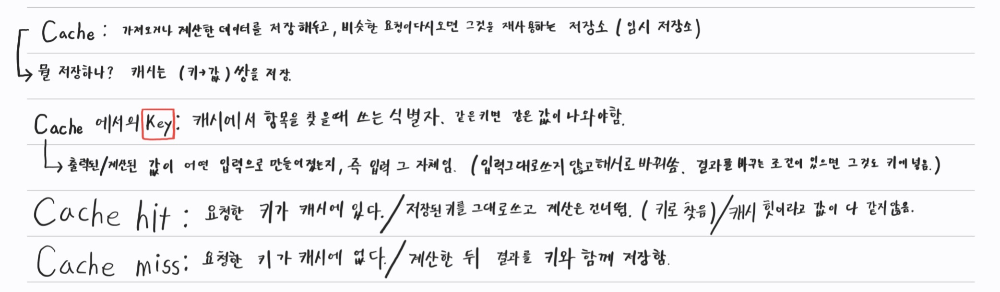

## 이 글은?{#section-zero}

제가 배운것을 남에게 설명하듯이 글을 작성해보는 공간입니다.

해당 공간에 작성되는 글은 모두 생성형 AI 등을 활용하지 않은 순수 타이핑으로만 작성된 글 입니다.

좀 더 상세한 수식과 딥한 내용은 다음 글에서 다룰 예정입니다!

## Cache란 무엇인가?{#section-one}

Cache란 일종의 임시 저장소를 이야기 합니다.

이미 계산한 데이터를 저장해두고, 동일한 요청이 들어오면 그것을 재사용하는 일종의 저장소 개념인 것이죠.

캐시는 기본적으로 계정이나 프로젝트 단위로 저장하며, [ 키, 값 ]의 쌍을 가집니다.

여기서 말하는 "키(Key)" 란? 입력 값을 의미합니다.

## Cache Hit? Miss?{#section-two}

API 호출 등을 통하여 모델을 만드신 분들이라면 다들 들어보셨을 개념입니다.

Cache Hit과 Cache Miss. 이게 뭐고 언제 발생하는지? 어떻게 계산되는지 궁금하셨던 적 없으신가요?

저도 여러 모델을 API를 통해 호출하는 경우 Dashboard에 Cache Hit과 Miss개념이 적혀있어서 이것이 왜, 언제, 어떻게 생성되는 것인지 여러모로 궁금했었습니다.

이번 기회를 통해 이것에 대한 개념을 완벽히 익혀보려 합니다.

### Cache는 어디에 저장되죠?

API 요청을 통해 모델을 사용하다 보면 일반적으로 이 요청에 대한 모델들의 응답은 모두 <b>"별개의 세션"</b>입니다.

즉, 모델은 이전의 요청과 응답을 기억하지 못한다는 것이죠!

그렇다면 Cache Hit과 같은 개념은 Dashboard에서 계속 쌓이던데 어디에 저장되는 것 일까요?

바로 API 운영사의 서버에 저장됩니다! 모델은 이 캐시안에 저장되어 있는 <b>"항목"</b>인 `키(Key)`를 가져오는 것이죠!

한가지 참고할 사항은 모델은 해당 키를 가져와서 계산은 다시합니다! 이전의 답변을 그대로 재활용 하지는 않습니다!

또한, API Prompt Caching의 성질로는 계정이나 프로젝트 단위로 구분(저장)되며,

이 캐시가 지워지는 것은 API의 운영사마다 다 다르다고 합니다! 이 개념을 알고 넘어가시는게 다음을 이해하기 좋습니다.

### Cache Hit

Cache Hit은 말 그대로 Cache가 적중했다! 라는 의미입니다. 현재 계정의 혹은 프로젝트에서 이전에 모델을 호출 했을때 맨 앞부터 정확히 같은 부분에 동일한 입력값이 있다면 해당 입력값을 계산할 때 사용한 중간 계산결과(K, V)를 가져와 다시 계산합니다. 

모델의 입장에서는 중간 계산결과를 생략할 수 있으니 비용도 아낄 수 있겠죠? 

이를 Cache Hit 이라고 합니다!

### Cache Miss

반대로 이전에 API 호출을 통해 저장된 캐시 중 현재 진행해야 할 작업에 관련된 내용이 저장되어 있지 않다면, 모델은 이에대한 계산을 처음부터 해야 합니다. 이런 상황에 Cache Miss를 나타내죠!

그래서 첫 호출시에는 Cache Miss가 전부입니다. 이전에 호출하여 쌓여있는 Cache가 없기 때문이죠!

## Workflow와 Agent의 차이{#section-three}

Anthropic의 24년 12월 기술 블로그에 올라온 글 "Building Effective Agents"에는 Agent와 Workflow를 다음과 같이 구분합니다.

<b>Workflow : LLM과 도구가 미리 정의된 코드 경로에 따라 조율되는 시스템 / 즉, 실행이 어떤식으로 될지 이미 정해져 있는것을 Workflow로 정의하고있습니다.</b>

<b>Agent : LLM이 자신의 처리 과정과 도구 사용을 동적으로 결정하는 시스템 / 즉, 매 단계 실행결과를 보고 그것을 근거로 다음 행동을 정하는 것을 Agent로 정의합니다.</b>

이 기술 블로그에서 주로 말하고자 하는 것은 하나씩 단계적으로 작업을 붙여서,

제일 처음에는 Model을 사용해보고, 이것만으로 안되는 경우 Workflow를 구축하고, 이것으로 해결되지 않는 경우 Agent를 구축하는 방향를 추구하는 것을 추천하고 있습니다.

## KV...?{#section-four}

중간에 Cache Hit을 설명할 때 잠깐 등장했었죠. <b>K, V</b> 이것과 함께 K, V, Q 라는 개념들이 있는데 이는 Attention이라는 개념에서 사용됩니다.

저도 이 개념은 Attention is All You Need 라는 논문이 있고, 이것이 현재 LLM의 기반인 Transformer 구조를 제안한 논문이다 라고만 알고 있었는데 이번 기회에 이것에 대해 공부해보려 합니다.

이에대해 좀 더 자세하게 다룬 내용을 다음 글로 정리해 올리겠습니다!