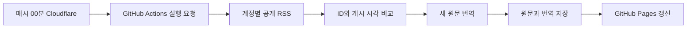

# News 관리

News는 X의 AI와 보안 계정 11개를 확인합니다. 본문을 누르면 X 원문으로 이동합니다. KO는 저장된 한국어 번역, EN은 수집 원문입니다. 임베드는 사용하지 않습니다.



## 키 등록과 시작

1. 변경사항을 `main`에 커밋하고 푸시합니다.
2. [저장소 Actions secrets](https://github.com/kiukmaster/kiukmaster.github.io/settings/secrets/actions)에서 **New repository secret**을 누릅니다.
3. 이름은 `OPENAI_API_KEY`, 값은 발급받은 OpenAI API 키입니다. 코드나 채팅에 키를 넣지 않습니다.
4. 아래 Cloudflare 예약 연결을 완료합니다. 즉시 실행하려면 [Actions](https://github.com/kiukmaster/kiukmaster.github.io/actions)에서 **Collect X news → Run workflow**를 선택합니다.

키는 번역 단계에만 전달합니다. 키가 없으면 원문 수집과 사이트 갱신은 계속되고, 번역 비활성 상태가 표시됩니다. 모델 접근 권한이나 잔액 문제는 Actions 로그의 오류 코드를 확인합니다.

## Cloudflare 예약 연결

예약만 Cloudflare로 옮깁니다. Worker는 GitHub에 실행을 요청하고 종료합니다. RSS 수집과 OpenAI 번역은 기존 GitHub Actions에서 수행합니다.

1. 먼저 `.github/workflows/news.yml`을 포함한 News 변경사항이 GitHub `main`에 반영되어 있어야 합니다.
2. GitHub의 [Fine-grained tokens](https://github.com/settings/personal-access-tokens)에서 토큰을 만듭니다. 대상 저장소는 `kiukmaster.github.io` 하나, Repository permissions는 **Actions: Read and write**로 제한합니다. 만료일도 설정합니다.
3. 설치한 Wrangler를 실행할 수 있는 터미널에서 프로젝트 루트를 기준으로 아래 명령을 실행합니다. Cloudflare CLI 로그인은 완료된 상태여야 합니다.

   ```powershell
   wrangler deploy --config cloudflare/news-scheduler/wrangler.jsonc
   ```

   설정 파일이 `kiuk-blog-news-scheduler` Worker의 코드와 예약을 함께 배포합니다. 기존 `kiuk-news-scheduler`는 다른 프로젝트용이므로 덮어쓰지 않습니다.
4. [Cloudflare 대시보드](https://dash.cloudflare.com/)의 **Workers & Pages → kiuk-blog-news-scheduler → Settings → Variables and Secrets**에서 Secret `GITHUB_ACTIONS_TOKEN`에 위 GitHub 토큰을 등록합니다. OpenAI 키를 이곳에 넣지 않습니다.
5. 설정 파일은 `workers.dev`와 Preview URLs를 비활성화하고 블로그 도메인 route를 만들지 않습니다. 매시 00분 예약 `0 * * * *`도 같은 파일에서 관리합니다. 예약 변경 전파에는 최대 15분이 걸릴 수 있습니다.

Worker 로그의 `workflow_run_id`는 GitHub가 요청을 접수했다는 뜻입니다. 수집 성공은 해당 GitHub 실행 결과에서 확인합니다. 토큰 만료나 권한 문제로 HTTP 401, 403 오류가 나면 토큰을 갱신합니다. HTTP 404는 저장소, workflow 파일과 접근 권한을 확인합니다.

예약을 변경할 때는 `cloudflare/news-scheduler/wrangler.jsonc`를 수정한 뒤 같은 배포 명령을 다시 실행합니다. 대시보드에서 별도로 예약을 추가하지 않습니다. 위 명령은 이미 설치된 Wrangler를 사용하며 새 패키지를 자동 설치하지 않습니다.

GitHub 자체 `schedule`은 제거했으므로 Cloudflare 연결 전에는 자동 수집이 시작되지 않습니다. 수동 실행과 수집 코드 변경 시 실행은 유지합니다.

2026-11-12 계정 반영: 사용자 승인으로 다른 `kiuk_news` 프로젝트의 첫 준비 예약을 통합했습니다. 실행 시각과 복구 예약을 유지하면서 `kiuk-news-scheduler`의 Cron이 5개에서 3개로 줄었습니다. 무료 한도에 블로그 예약을 추가할 자리가 확보되었습니다.

## 시간과 수집 범위

- Cloudflare 예약식은 `0 * * * *`입니다. 한국 시간으로도 매시간 00분입니다. PC를 켜둘 필요가 없습니다.
- GitHub 예약 대기를 건너뛰지만 실행기 대기와 수집, 번역, Pages 배포 시간은 남습니다. 정각 게시 완료를 보장하지 않습니다.
- 각 계정의 `https://nitter.gq/계정명/rss`를 순서대로 읽습니다. X 공식 API와 로그인 쿠키는 사용하지 않습니다.
- 처음에는 모든 계정의 응답이 정상이고 후보가 10개 이상일 때 전체 최신 10개를 선택합니다. 그 수집을 시작한 시각을 영구 저장합니다.
- 초기 조건을 충족하지 못하면 시작 대기 상태를 유지합니다. 번역은 시작하지 않습니다.
- 이후에는 시작 시각 이후에 게시된 새 ID만 추가합니다. 오래된 고정글은 제외합니다. 이미 보관한 글의 본문 수정은 반영합니다.
- 답글과 단순 재게시는 제외합니다. News는 최신 10개, 더보기는 이후 수집 기록을 30개씩 보여줍니다.

로컬에서 가져왔던 187개는 최신 10개만 남겼습니다. 운영을 시작할 때 최신 10개를 다시 선정하며, 이전 글 전체를 소급 수집하거나 번역하지 않습니다.

## 번역과 비용

`gpt-6.1-sol`, `reasoning.effort: medium`으로 고정합니다. Responses API로 수집 본문을 번역합니다. 대상은 최대 1,200자이며 링크된 기사 전체와 이미지 속 글자는 포함하지 않습니다. URL만 있는 글은 호출하지 않습니다.

동일 게시물 ID, 원문 SHA-256, 모델, 추론 강도, 번역 지침 버전의 성공 결과를 재사용합니다. 원문이 바뀌면 새 번역 대상이 되고 이전 성공 결과도 보관합니다. 실패하거나 대기 중인 글은 원문을 보여줍니다.

| 제한 | 값 |
|---|---|
| 한 번의 실행 | 최대 20회 요청, 내부 3분 15초 |
| HTTP 요청 | 45초 |
| 출력 | 최대 4,096토큰, 추론 토큰 포함 |
| 동일 원문 시도 | 최대 2회, 같은 실행에서 재시도 없음 |
| Actions 번역 단계 | 최대 4분 |

시간과 요청 수 제한에 걸린 글은 다음 실행으로 넘어갑니다. 키 오류, 모델 접근 불가, 할당량 부족은 항목의 시도 한도를 소모하지 않고 그 실행의 추가 호출을 멈춥니다. 일시적인 실패는 다음 실행에서 남은 횟수만큼 처리합니다.

RSS 수집은 무료지만 OpenAI API는 별도 과금됩니다. 위 제한은 월 결제 상한이 아닙니다. 응답 소실이나 원격 저장 실패가 있으면 같은 요청이 다시 과금될 가능성이 남습니다.

## 수정 위치

| 내용 | 파일 |
|---|---|
| 수집 계정 | `data/news_sources.json` |
| 매시 00분 예약과 실행 요청 | `cloudflare/news-scheduler/worker.mjs`, `wrangler.jsonc` |
| 수집과 번역 자동 실행 | `.github/workflows/news.yml` |
| 수집과 시작 시각 관리 | `.github/scripts/collect-news.py` |
| 번역과 호출 제한 | `.github/scripts/translate-news.py` |
| 최초 배포와 로컬 미리보기 | `data/news.json`, `data/news_translations.json` |
| 운영 중 누적 기록 | `news-data` 브랜치의 `news.json`, `news_translations.json` |

계정 설정에는 `handle`, `label`, `topic`, `topicEn`을 입력합니다. `handle`에 `@`는 붙이지 않습니다. 새로 추가한 계정도 기존 시작 시각 이전의 글은 수집하지 않습니다.

원문과 번역은 `news-data`의 같은 커밋으로 저장합니다. `main`에는 매시간 수집 기록을 커밋하지 않습니다. 수집 작업 완료 후 Pages가 두 파일을 같은 커밋에서 읽어 배포합니다.

손상된 파일이나 원격 읽기 오류는 빈 데이터로 덮어쓰지 않습니다. 일부 계정이나 번역이 실패해도 저장 가능한 결과를 먼저 보존하고 실패를 보고합니다. 작업 전체 취소나 저장 실패까지 보존을 보장하지는 않습니다.

무료 RSS가 중단되거나 글을 누락할 수 있습니다. RSS에서 이미 빠진 글을 다음 실행에서 복구한다고 보장하지 않습니다.

출처: [RSS 제공자](https://nitter.gq/about), [Cloudflare 예약](https://developers.cloudflare.com/workers/configuration/cron-triggers/), [Cloudflare Secrets](https://developers.cloudflare.com/workers/configuration/secrets/), [GitHub 실행 요청](https://docs.github.com/en/rest/actions/workflows#create-a-workflow-dispatch-event), [GitHub Secrets](https://docs.github.com/en/actions/how-tos/write-workflows/choose-what-workflows-do/use-secrets), [모델 문서](https://developers.openai.com/api/docs/models/gpt-6.1-sol), [Responses API](https://developers.openai.com/api/reference/resources/responses/methods/create).
